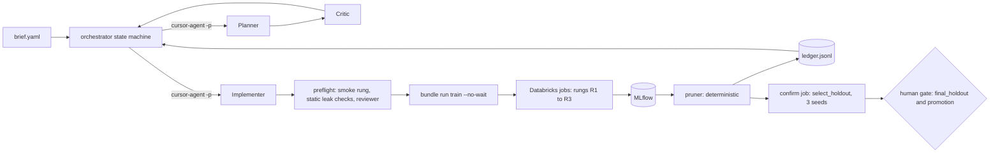
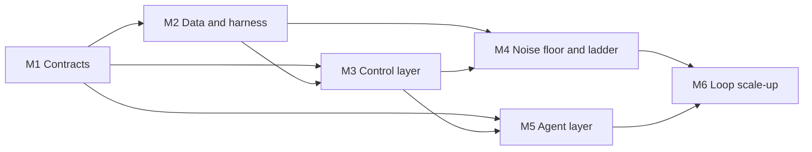
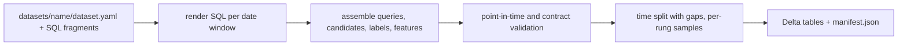

# Automated Model Trainer (AMT): MVP Implementation Plan

Nov 12, 2026 · revision of "Automated Model Trainer: Architecture and Implementation"

## 0. Summary

The MVP takes one brief (a YAML file) and returns a short, verified list of ranked model candidates, each with confidence intervals, measured cost and an audit trail. It also returns a clean "no winner" report if nothing beats the baseline. The first target is the **News For You (NFY) article reranker**, scored by NDCG@10 on logged For You feed sessions.

The original spec is mostly right. The research changes three things:

1. **The workflow runs as code, not as a prompt.** A Python state machine decides which stage comes next. Agents are stateless calls that read files and write files. In the RankEvolve study, none of 10 runs followed a prompt-only procedure faithfully.
2. **Evaluation hygiene comes before search cleverness.** Use three data tiers (one the agents can see, a private selection holdout, and a final holdout), evaluate with locked harness code, prune on paired noise-aware comparisons, and pick the final model from the top 3 rather than the single best validation score. AIRA, AIDE² and RankEvolve all found validation overfitting and leakage to be the main failure, not weak search.
3. **Search is iterative, not one-shot.** Start with a diverse set of drafts across model families, then improve the surviving lineages with single-variable changes, with fork-on-plateau, then run one combination round. Do not use MCTS; it gave no gain in AIRA, and AIDE² tried it and rejected it.

The phases, ordered by dependency:

- **Phase 0**: Databricks plumbing plus a walking skeleton of the agent loop.
- **Phase 1**: milestones M1–M6, covering contracts, a generic spec-driven data builder and harness, the control layer, the noise floor and ladder validation, the agent layer, and then scaling up the loop.
- **Phase 2**: a staged test of the whole system on the NFY brief, from data validation through red-team tests, an unattended run, confirmation and reproducibility.

---

## 1. Research findings that change the design

| Source | Finding | Design consequence |
| --- | --- | --- |
| AIDE ([arXiv 2502.13138](https://arxiv.org/abs/2502.13138)) | Solution tree with Draft, Debug and Improve operators. Improve makes one atomic change. Greedy search gets stuck in local optima and code complexity grows. | Typed operators. Improvements are single-variable. Debug depth is capped. The harness computes the metric; the LLM never parses it from logs. |
| AIDE² (Weco, [arXiv 2609.26457](https://arxiv.org/abs/2609.26457)) | Keeps a harness rewrite only if it improves a **private** score under a fixed budget. The winning search is a UCB bandit over strategy arms, greedy expansion within an arm, and a fork every 5 steps. MCTS, island genetic algorithms and LLM tournaments were rejected. Context is bounded (one-line summaries of the 12 newest nodes plus one full solution). Run-to-run noise of 0.02–0.045 was larger than most deltas. | Private selection split. Bandit plus greedy plus fork-on-plateau. Small, role-scoped context. Noise-aware promotion. |
| AIRA-dojo (Meta, [arXiv 2507.02554](https://arxiv.org/abs/2507.02554)) | Operators matter more than search policy: MCTS and evolutionary search gave nothing with AIDE's operators. Validation keeps rising while test plateaus. Selecting by test instead of validation would add 9–13 medal points. Submitting the top 3 by validation recovers about 10% of that. A 4-hour cap per execution was enough. | Spend engineering effort on operators. Re-score the top 3 on a private holdout with multiple seeds. Cap wall-clock per job. Use scoped memory per operator. |
| MLE-bench ([arXiv 2410.07095](https://arxiv.org/abs/2410.07095)) | Agents ignore time and compute limits. Free-form scaffolds quit early. pass@k is much higher than pass@1. | The harness and Databricks enforce budgets. Use a forced structured loop. Keep several final candidates. |
| R&D-Agent ([arXiv 2505.14738](https://arxiv.org/abs/2505.14738)) | Diverse first layer, then greedy exploitation per branch, then merge: removing this cost 28%. Planning by phase (no ensembles early) mattered: removing it cost 24%. Debugging on a data sample first: removing it dropped results from 34.7% to 24.0%. The harness owns the splits. | Round structure: drafts, then improve, then combine. A smoke rung on sampled data. Complexity cues by phase. |
| MLE-STAR ([arXiv 2506.15692](https://arxiv.org/abs/2506.15692)) | A leakage checker before execution caught target leakage. Ablation-guided refinement. | Recommender-specific leakage checks before any compute is spent. An "ablate" operator. |
| AlphaEvolve ([arXiv 2506.13131](https://arxiv.org/abs/2506.13131)), OpenEvolve, ShinkaEvolve ([arXiv 2509.19349](https://arxiv.org/abs/2509.19349)) | Evaluation cascade (cheap tests first), an archive of programs with lineage, diff-based edits, a fast and strong LLM pair. Embedding-based rejection of near-duplicate ideas was the cheapest large win. | Rungs act as the cascade. Ledger as an archive with parent links. Near-duplicate rejection, as a Phase 1 stretch goal. |
| AI co-scientist ([arXiv 2502.18864](https://arxiv.org/abs/2502.18864)) | Elo ranking is self-assessed, not ground truth. Children are new entries, never in-place edits. | The LLM critic is a triage filter only. Promotion is deterministic. Nodes are immutable. |
| AI Scientist v1/v2, "Hidden Pitfalls" ([arXiv 2509.08713](https://www.alphaxiv.org/abs/2509.08713)) | Agents edited their own timeouts, silently left parameters unchanged, swapped metrics, and picked the worst candidate 49% of the time when test results were planted. | Limits live outside agent-editable code. The reviewer checks that the claimed change is actually present in the diff. Agents never see holdout scores. |
| RankEvolve ([arXiv 2609.39551](https://ar5iv.labs.arxiv.org/html/2609.39551)), YouTube self-evolving recsys ([arXiv 2602.10226](https://arxiv.org/abs/2602.10226)), Meta REA | NDCG@10 ranking agents leaked held-out data and mined negatives from target data. A fast evaluation subset ran 0.005–0.010 optimistic. Prompt-only protocols drifted. Cross-review by a different model raised accuracy from 45.8% to 62.5%. Every system uses a code-enforced workflow, a journal of negative results and an upfront budget approval. | State machine. Reviewer on a different model. Full-set re-scoring of finalists. Budget approved up front by a human. |

Caveats: the RankEvolve, AIDE² and YouTube figures come from recent preprints that were only partly read. The designs of the 2026 MLE-bench leaders are closed-source and unverified.

---

## 2. Critique of the current spec

Each item below names a gap in the spec and the fix this plan adopts.

1. **The orchestrator is a plain-English command.** The control flow would live in a prompt, which is the documented failure mode. *Fix:* `amt/orchestrator.py` is a resumable state machine. `/orchestrate` is only a thin human entry point that calls it.
2. **There is only one evaluation split plus a final holdout.** The pruner ranks on the same split the agents iterate against, so the winner partly fits noise. *Fix:* three tiers. `search_val` is visible to agents (as aggregate scores only). `select_holdout` is used only by the confirmation job. `final_holdout` is opened once, at the human gate.
3. **Kill rules compare low-fidelity runs to a full-fidelity baseline.** "Upper confidence bound below baseline plus `min_effect`" at rung 1 kills everything, because low rungs are biased downward. *Fix:* the baseline is re-run at every rung. Candidates are compared on the **paired per-query difference** against the same-rung baseline. The kill threshold tightens with rung.
4. **Noise is assumed to be measured per request.** Our data shows a within-day standard error of about 0.002 but a day-to-day swing of about 0.02 (section 6.2). *Fix:* confidence intervals come from a **day-blocked paired bootstrap**, resampling days and then queries within each day. Paired differences remove most of the day effect.
5. **The brief schema has no ranking task definition.** It does not say what a query is, what the candidate set is, how labels are graded, or which features are allowed at serve time. These are the main sources of leakage in recommender systems. *Fix:* add a `task` block (query unit, candidates, labels, allowed serve-time inputs, forbidden columns).
6. **The planner proposes N candidates once.** There are no improvement rounds on winners. *Fix:* draft round, then improve rounds per lineage with fork-on-plateau, then one combination round.
7. **The reviewer runs after successive halving.** Leakage or spec bugs would burn compute before anyone catches them. *Fix:* a pre-flight review (static leakage checks plus a spec-conformance check by the reviewer model) runs before rung 1, and a final review runs before confirmation.
8. **The learning-curve kill rule ("trails the median at the same step") assumes comparable steps.** Gradient-boosted trees and neural nets do not share a step axis. *Fix:* drop it for the MVP and prune only at the end of each rung. It can return once families have rung-validated curves.
9. **The budget is in GPU-hours.** Most strong rankers here (LightGBM) run on CPU, and Databricks bills in DBUs. *Fix:* budget in DBUs plus a wall-clock cap per rung. Live spend is estimated as wall-clock × cluster DBU rate and reconciled later against `system.billing.usage` by job run tag.
10. **There is one git worktree per candidate.** That adds sync overhead with Databricks bundles for little isolation gain. *Fix:* use plain `candidates/<id>/` directories, with write scope enforced by a hook and a pre-flight path check. Each batch is committed, the bundle is deployed once, and the git SHA is tagged on every MLflow run. Worktrees can be added later if parallel implementers collide.
11. **Two sources of truth (MLflow and the ledger file).** *Fix:* MLflow holds runs and metrics. `ledger/results.jsonl` is append-only and written **only** by scripts (pruner and orchestrator), never by agents.
12. **"Private" splits are not actually enforced.** Agents can read harness code and may hold SQL access. *Fix:* candidate code never receives holdout frames. It cannot do I/O beyond the frames passed to `fit` and `score`; a static check rejects `spark.`, table names, `open()` outside its directory, and network calls. Confirmation runs in a separate job that only the orchestrator triggers.
13. **The serving latency benchmark is undefined.** *Fix:* p95 latency to score one request of 100 candidates on a fixed single-node CPU type, single-threaded, with features already materialised. It is reported relative to the reference model.
14. **The fidelity check needs known-good and known-bad designs per family, but none are named.** *Fix:* section 5.4 defines pairs for each family and a Kendall τ acceptance threshold.

---

## 3. Final architecture (revised)



### 3.1 Repository layout

```
amt/                     control layer (agents never edit)
  schemas.py             pydantic: Brief, Candidate, Verdict, LedgerRow, RunState
  orchestrator.py        resumable state machine; one command: amt run briefs/<task>.yaml
  agents.py              wrapper around `cursor-agent -p` (role, model, inputs, outputs, timeout, token log)
  context.py             builds scoped context per role (ledger summaries, siblings, fix chain)
  ledger.py              append-only writer for ledger/results.jsonl
  pruner.py              deterministic rules (section 5.3)
  status.py              human-readable run status; --audit checks the trace of every ledger row
  budget.py              DBU pool, per-candidate caps, spend reconciliation
  preflight.py           static checks on candidate code
harness/                 read-only to agents; no dataset-specific code
  data/contract.py       output contract every dataset produces (query_id, item_id, query_ts, event_day, label, feat.*, ref.*)
  data/build_dataset.py  Databricks job: --spec datasets/<name>; point-in-time build, splits, samples, content hashes
  data/checks.py         generic data checks plus the spec's own checks
  interface.py           Ranker protocol and RankingFrame
  train.py               entry point: --candidate_id --rung --seed --split --batch
  evaluate.py            NDCG@k (graded), MRR, day-blocked paired bootstrap
  latency.py             fixed latency benchmark
  baselines/             reference_score (one per ref.* column), popularity, random, lgbm_reference
datasets/<name>/         dataset.yaml + SQL fragments; one folder per surface (section 5.2)
  nfy_article_rerank/    first spec
  nfy_clip_rerank/       second spec, proves the builder is generic
candidates/<id>/
  candidate.yaml         planner output, after the critic's verdict
  spec.md                acceptance criteria and interface notes
  model.py               implements Ranker
  debug_log.md           chain of fix attempts
  review.md              ends with "VERDICT: PASS" or "VERDICT: FAIL"
briefs/nfy_article_rerank.yaml
.cursor/agents/{planner,critic,implementer,reviewer}.md   role prompts (single source for chat and headless)
.cursor/commands/orchestrate.md                            thin entry point
.cursor/hooks.json                                         block writes outside candidates/<id>/
databricks.yml + resources/                                jobs: build_dataset, train, confirm, pruner
ledger/results.jsonl
runs/<run_id>/state.json, round_<n>.md, ESCALATE.md, report.md
tests/
```

### 3.2 Agent roles and models

| Role | Reads | Writes | Model guidance |
| --- | --- | --- | --- |
| Planner | brief, ledger summary (newest 12 nodes plus best per family), parent node in full when improving | `proposals.yaml` (N candidates) | Strongest reasoning model |
| Critic | brief, proposals, ledger summary | verdict per candidate: PASS, REVISE or DROP, with a reason | Different model family from the planner |
| Implementer | `spec.md`, harness interface, parent `model.py` when improving, fix chain when debugging | `candidates/<id>/*` only | Fast coding model |
| Reviewer | spec, diff, preflight output, rung metrics | `review.md` with verdict | Different model from the implementer |

Each call gets a fresh context, file paths only, a wall-clock timeout and a token cap. The orchestrator logs per-call cost.

### 3.3 Operators

- **Draft**: a new design from an allowed family.
- **Improve**: exactly one atomic change to a parent node, with the claim stated.
- **Debug**: given the traceback and the full fix chain. Maximum depth 3, then the node is marked failed.
- **Ablate**: remove one feature group or component to locate where the gain comes from. Used before improving a lineage that has plateaued.
- **Combine**: blend the scores of the top 2 lineages, or stack them. Used once, in the last round.

A complexity cue is given by phase: round 1 asks for simple, well-understood designs, with no ensembles and no heavy tuning.

### 3.4 Search loop per brief

1. **Round 0, baselines**: every reference score the dataset spec declares (for NFY, production score and recency), popularity, random and the LightGBM reference, at every rung with 3 seeds. This sets the noise floor and confirms `min_effect`.
2. **Round 1, diverse drafts**: the planner proposes N=8. The critic keeps K=4, with at least 3 families. Near-duplicates (same family, same feature set) are rejected. Successive halving runs over R1→R2→R3.
3. **Rounds 2–3, improve lineages**: take the top 2 lineages. The planner proposes 3 atomic improvements each; the critic keeps 2 each. They run R2→R3, skipping R1 because the family is already validated. Fork-on-plateau: if a lineage's last 2 improvements are each below the noise floor, stop expanding it and spend its budget on one new draft from an unexplored family.
4. **Round 4, combine**: one blend or stack of the top 2 lineages.
5. **Confirm**: the top 3 at R3 are retrained with 3 seeds and scored on `select_holdout`. The winner and runner-up, plus the baselines, are scored once on `final_holdout`. The report goes to a human.

Every loop has a cap: at most 1 critic revision, 3 debug attempts, 4 rounds and 2 outer retries. At any cap, or when the budget is exhausted, the orchestrator writes `ESCALATE.md` and stops.

The loop does not wait on humans between rounds. With the default `approval_mode: none`, the orchestrator writes a non-blocking digest after each round (`runs/<id>/round_<n>.md`) and carries on; a human can halt it with `amt stop`. Approval modes and the blocking gates are described in sections 5.5 and 7.

---

## 4. Phase 0: Setup, Databricks plumbing and the agent-loop walking skeleton

**Goal:** one command runs a trivial candidate from brief to ledger row, with every hop traceable. The trace runs from ledger row to Jobs run ID to MLflow run to git SHA.

### 0.1 Environment
- Upgrade the Databricks CLI. The installed version is v0.250.0, below the v1.0 floor: `brew upgrade databricks`.
- Re-authenticate. All 5 profiles currently show `Valid: NO`. Run `databricks auth login --host https://fox-product-eng-dev-nation.cloud.databricks.com --profile <name>`, and have the human choose the profile.
- For the MVP, jobs authenticate with a developer personal access token. A service principal is out of scope until after the MVP.
- `git init`, a `uv` project on Python 3.11, `ruff` and `pytest`, and the repo skeleton from section 3.1.

### 0.2 Databricks plumbing
- Write AMT dataset snapshots and artifacts to `product_api_dev.amt` (new schema). Create the schema and a volume `amt_artifacts`. Access is granted by whoever owns `product_api_dev` (confirm the grantor when creating the schema).
- Create the MLflow experiment `/Shared/amt/nfy_article_rerank`.
- Create a bundle with a `hello_train` job that takes `candidate_id`, `rung`, `seed` and `batch`. It logs a dummy metric with tags `candidate_id`, `family`, `rung`, `batch`, `git_sha` and `dbu_est`. Give it job-level `timeout_seconds`, `max_concurrent_runs` and a cluster policy that restricts node types. Jobs run under the developer's token for the MVP.
- Verify that `databricks bundle run hello_train --params ... --no-wait` returns a run ID. Verify that the Jobs API polling and the MLflow search by tags both work from the laptop.
- Check GPU availability: which GPU node types the cluster policies allow under a developer identity, and the startup time. Also check serverless job compute for the smoke rung.

### 0.3 Data validation

This is partly done; results are in section 6.2.
- Canonical table names are confirmed: `pnr_prod.silver.news_interactions` and `pnr_prod.silver.news_impressions` (not the `pr_news_*` names that appeared in an earlier brief draft).
- Confirm what `news_interactions.context_embedding_3072` embeds (the article or the session context), and check impression de-duplication using `latest_impression_rn`.
- Measure the join coverage from `nfy_reco_requests.(user_profile_key, profile_content_hash)` to `nfy_user_profile_versions`, which gives point-in-time user features.

### 0.4 Agent-loop plumbing
- Confirm the current `cursor-agent` headless flags (prompt mode, model selection, JSON output, non-interactive file writes), how auth works in unattended runs, and which models are available. Confirm the `.cursor/agents` frontmatter and the `hooks.json` schema against the current docs.
- Write `amt/agents.py` and a toy loop on a tiny sample table. The planner writes 1 proposal; the critic passes it; the implementer writes `candidates/c00/model.py` (logistic regression); the smoke test runs; the job is submitted to `hello_train`; a pruner stub reads MLflow; `status.py` prints the result.
- Record per-agent latency, tokens and failure rate. These numbers size the Phase 1 timeouts.

### Exit criteria
- `amt run briefs/toy.yaml` completes unattended.
- Killing the process mid-run and re-running resumes from `runs/<id>/state.json` without resubmitting jobs (idempotent submission keyed by `candidate_id/rung/seed`).
- A write outside `candidates/<id>/` by the implementer is blocked by the hook.

---

## 5. Phase 1: Implementation

The control layer is built and tested before any agent can spend compute. The work is ordered by dependency rather than by calendar: a milestone starts once the milestones it depends on are done. Each milestone lists the files involved, the key design points, and a "done when" condition.



M4 and M5 can proceed in parallel once M3 is done.

### 5.1 M1: Contracts

- Files: `amt/schemas.py` and `amt/ledger.py`, plus the JSON Schemas exported to `amt/json_schemas/` for the agent prompts.
- Pydantic models:
  - `Brief`, including the `task` block and the `dataset_spec` pointer (section 6.1).
  - `Candidate`: `id`, `parent_id`, `operator`, `kind`, `family`, `claim`, `fit_argument`, `change`, `cheap_test`, `kill_if`, `est_cost`.
  - `Verdict`: `PASS`, `REVISE` or `DROP`, plus a reason.
  - `LedgerRow`: `run_id, node_id, parent_id, round, operator, kind, family, claim, rung, seed, metric, delta_vs_baseline {point, ci_lo, ci_hi}, dbu, wall_min, latency_p95_ms, status, kill_reason, git_sha, mlflow_run_id, job_run_id`.
  - `RunState`: current stage and round, live nodes, submitted job keys, spend, and the run settings (K, budget, `approval_mode`).
- MLflow tag convention, set on every run: `run_id, node_id, parent_id, family, operator, rung, seed, batch, split, git_sha`.
- The ledger (`ledger/results.jsonl`) is append-only, and only the scripts in `amt/` write to it. Agents never do.
- Done when: round-trip tests pass, and a malformed agent output comes back as a validation error that the orchestrator returns to the agent (it counts as one revision).

### 5.2 M2: Data and harness

#### Dataset builder

The builder is generic and spec-driven. It contains no code specific to NFY or any other surface: adding a new surface means adding a spec folder, not changing harness code.



- **Spec**: `datasets/<name>/dataset.yaml`, plus SQL fragments in the same folder. A brief points to it with `dataset_spec: datasets/<name>`. The spec declares:
  - `task_type`: `ranking` for the MVP. `pointwise` is an extension point.
  - `sources`: tables, plus partition-filter templates, so large tables are always pruned by partition.
  - `queries.sql`: one row per query, with `query_id` and `query_ts`.
  - `candidates.sql`: rows of `query_id, item_id`.
  - `labels.sql`: the graded label per `(query_id, item_id)`, with a `label_window` after `query_ts`.
  - `feature_groups`: each group has a SQL fragment, join keys and an `available_at` column.
  - `reference_scores`: existing production score columns, used as baselines.
  - `filters`: for example, `include_query_if`.
  - `forbidden_columns`.
  - `split`: the time column, windows for `train`, `search_val`, `select_holdout` and `final_holdout`, and `gap_days`.
  - `sampling`: the smoke sample size, the data fraction for each rung and the evaluation query cap.
  - `checks`: optional dataset-specific assertions, for example "the reference metric reproduces within 0.005".
- **Output contract**, `harness/data/contract.py`. Every dataset produces the same columns:
  - `query_id, item_id, query_ts, event_day, label`.
  - Optional `aux_label.*` columns for secondary metrics.
  - `feat.*` columns, with per-group availability metadata.
  - `ref.*` reference scores.

  The harness, evaluation, baselines and pruner read only this contract, so they never depend on which dataset is behind it.
- **Builder**, `harness/data/build_dataset.py`, runs as a Databricks job with `--spec datasets/<name>`. It:
  1. Renders the SQL fragments for each date window.
  2. Assembles queries, candidates, labels and features.
  3. Enforces point-in-time correctness: every feature's `available_at` must be on or before `query_ts`, and every label must fall inside `label_window`.
  4. Validates the contract: types, exactly one label per pair, candidates per query within bounds, and no forbidden columns.
  5. Splits by time with gaps.
  6. Draws seeded query-level samples for the smoke test and each rung.
  7. Writes `<catalog>.<schema>.<dataset>_<split>` Delta tables and `manifest.json`, which records the spec hash, row counts, date ranges and content hashes.
- **Generic checks**, `harness/data/checks.py`: label distribution, null rates per feature, queries per day, candidates per query, and the spec's own `checks`.

#### First spec: `datasets/nfy_article_rerank/`

The NFY joins profiled earlier (section 6.2) live in this spec, not in harness code:

- Requests to served candidates.
- Candidates to For You impressions within 30 minutes, filtered by partition.
- Impressions to interactions, giving graded labels only when there was a click.
- Requests to profile versions, by profile key and hash.
- Production `total_score` declared as a `ref.*` score.

A sketch of the spec follows. Column names in the SQL fragments are written against the tables profiled in Phase 0.

```yaml
# datasets/nfy_article_rerank/dataset.yaml
name: nfy_article_rerank
task_type: ranking

sources:   # every source is read through its partition filter for the window being built
  requests:     {table: pnr_prod.silver.nfy_reco_requests,   partition_filter: "{date_col} BETWEEN '{start}' AND '{end}'"}
  candidates:   {table: pnr_prod.silver.nfy_reco_candidates, partition_filter: "{date_col} BETWEEN '{start}' AND '{end}'"}
  impressions:  {table: pnr_prod.silver.news_impressions,    partition_filter: "{date_col} BETWEEN '{start}' AND '{end}'"}   # confirmed; not pr_news_*
  interactions: {table: pnr_prod.silver.news_interactions,   partition_filter: "{date_col} BETWEEN '{start}' AND '{end}'"}  # confirmed; not pr_news_*
  profiles:     {table: pnr_prod.silver.nfy_user_profile_versions}   # joined by user_profile_key + profile_content_hash
  articles:     {table: pnr_prod.bronze.news_article_feature}

queries: queries.sql        # one nfy_reco_requests row, entity_type = 'article'; query_ts = request_ts
candidates: candidates.sql  # candidate_status = 'served', impressed on page_type = 'for-you' within 30 min, matched on xid + entity_id
labels:
  sql: labels.sql           # 0 impressed, 1 click, 2 click + engaged_read, 3 click + deep_read; dwell counts only with a click
  label_window: 24h         # placeholder; confirm against dwell latency in Phase 0
  aux_labels: [click]

feature_groups:
  profile:      {sql: features/profile.sql,      keys: [query_id],          available_at: profile_version_ts}    # version referenced by the request
  prod_signals: {sql: features/prod_signals.sql, keys: [query_id, item_id], available_at: query_ts}              # 12 signals, total_score, trending_score, rank, bucket_sources, item_age_seconds, is_breaking
  article:      {sql: features/article.sql,      keys: [item_id],           available_at: published_ts}          # category, IPTC, entities, topic, tone, evergreen, geo scope, title
  context:      {sql: features/context.sql,      keys: [query_id],          available_at: query_ts}              # hour, DMA, cold start
  popularity:   {sql: features/popularity.sql,   keys: [query_id, item_id], available_at: popularity_window_end} # impressions strictly before request_ts

reference_scores: {production: total_score, recency: -item_age_seconds}
filters: {include_query_if: "max(label) >= 1"}   # at least one click
forbidden_columns: [item_index, display_position, latest_profile_*]

split:
  time_col: query_ts
  gap_days: 1
  train:          2026-09-14..2026-10-18
  search_val:     2026-10-20..2026-10-26
  select_holdout: 2026-10-28..2026-11-02
  final_holdout:  2026-11-04..2026-11-10

sampling:
  seed: 0
  smoke: {train_queries: 2000, eval_queries: 1000}
  rungs:
    R1: {train_fraction: 0.10, eval_queries: 20000}
    R2: {train_fraction: 0.40, eval_queries: 60000}
    R3: {train_fraction: 1.00, eval_queries: all}

checks:
  - {name: prod_ndcg_reproduces, score: ref.production, metric: ndcg@10_click, split: search_val, expected: checks/prod_ndcg.sql, tol: 0.005}
  - {name: queries_per_day, min: 30000}
  - {name: candidates_per_query_mean, between: [20, 40]}
```

The brief's `task` block remains the human-readable task definition that the critic and reviewer check proposals against. The spec is its executable form, and the two are reviewed together at gate G1.

#### Harness

- **Interface**, `harness/interface.py`. `RankingFrame` is a typed view over the output contract. `FitContext` carries the seed, deadline, device and a restricted metric logger.

```python
class Ranker(Protocol):
    def fit(self, train: RankingFrame, valid: RankingFrame, ctx: FitContext) -> None: ...
    def score(self, frame: RankingFrame) -> np.ndarray: ...  # labels stripped by harness
    def save(self, path: str) -> None: ...
    @classmethod
    def load(cls, path: str) -> "Ranker": ...
```

- **Training entry point**, `harness/train.py`: takes `--candidate_id --rung --seed --split --batch`. It loads the rung's frames, imports `candidates/<id>/model.py`, trains under the deadline, scores the evaluation split, and logs metrics and latency to MLflow with the M1 tags. A run that ends with no metrics is logged as `failed`.
- **Evaluation**, `harness/evaluate.py`: graded NDCG@10 (primary), click NDCG@10, MRR and coverage@10. It also computes the day-blocked paired bootstrap (1,000 resamples) for the per-query Δ against a named baseline run on the same rung and seed set.
- **Latency benchmark**, `harness/latency.py`: p95 latency for one request of 100 candidates, single-threaded, on a fixed CPU node type, as defined in critique item 13.
- **Generic baselines**, `harness/baselines/`. None of them is tied to a dataset:
  - `reference_score`: one per `ref.*` column the spec declares. For NFY that is the production score and recency.
  - `popularity`: item click rate computed from the train split only.
  - `random`.
  - `lgbm_reference`: LightGBM lambdarank over all numeric `feat.*` columns.
- **Bundle**, `databricks.yml` and `resources/`: jobs `build_dataset`, `train`, `confirm` and `pruner`. Each has job-level `timeout_seconds`, `max_concurrent_runs` and a cluster policy.

#### Fidelity ladder

The data sizes come from the spec's `sampling` block; the values shown are the NFY ones.

| Rung | Train data | Eval data | Wall cap | Compute |
| --- | --- | --- | --- | --- |
| R0 smoke | 2k queries | 1k queries | 10 min | serverless or a small single node |
| R1 | 10% of train queries (last ~1 week) | 20k search_val queries | 30 min | CPU, or 1 GPU for neural nets |
| R2 | 40% | 60k | 90 min | same |
| R3 | 100% | full search_val | 4 h | same |
| Confirm | R3 config, 3 seeds | select_holdout | 4 h each | same |

R0 checks that the model imports, the loss decreases, the score shape is correct, there are no NaNs, results are deterministic under a fixed seed, and the latency probe runs. Only then does the node reach R1.

#### Done when

- The builder passes tests on a synthetic dataset spec with planted leaks (a feature available after `query_ts`, a label outside its window, a forbidden column), and rejects each one.
- Generality is proven: a second spec builds and trains end to end with no harness code change. The candidate is `datasets/nfy_clip_rerank/`, which uses the same tables with `entity_type='clip'`.
- The NFY spec's built-in check passes: the production score's NDCG@10 on `search_val` matches the SQL measurement within 0.005. The splits do not overlap in time, and the hashes are stable on rebuild.
- All baselines run at every rung on both specs.

### 5.3 M3: Control layer, with no agents involved

- **Pruner**, `amt/pruner.py`: a pure function `decide(rung, runs, baseline_runs, brief) -> RungDecision`, wrapped as a Databricks job and as a CLI, so the orchestrator can call it either way. Rules are applied at the end of each rung, always on Δ against the **same-rung** LightGBM reference (and every `ref.*` score), computed per query and day-blocked:
  - **Hard kills**: NaN or divergence; a run that terminated with no metrics; measured p95 latency above the brief limit; per-candidate DBU cap exceeded; preflight or review FAIL.
  - **Below-floor kill**, with the threshold tightening at each rung: at R1, kill if the upper bound of Δ is below `-min_effect` (clearly worse). At R2, kill if the upper bound is below 0. At R3, kill if the upper bound is below `min_effect`.
  - **Dominance**: kill A if some B at the same rung has a paired lower bound of (Δ_B − Δ_A) above 0 **and** B's training DBU and latency are both no higher than A's.
  - **Halving**: among the remaining candidates, keep the top ⌈n/2⌉ by Δ point estimate. One **diversity slot** guarantees that the best surviving node of an otherwise-eliminated family continues past R1.
  - **Promotion to confirm**: the top 3 at R3 whose Δ lower bound is above 0.

  The pruner writes `runs/<id>/rung_<r>_survivors.json` and appends ledger rows with reasons.
- **Budget**, `amt/budget.py`: the DBU pool and per-candidate caps. Live spend is estimated as wall-clock × cluster DBU rate. It refuses any submission that would push the pool below zero.
- **Status**, `amt/status.py`: a table of live nodes, spend versus pool, and kills with their reasons. `status.py --audit` confirms that every ledger row links to a job run, an MLflow run and a git SHA.
- **Confirmation job**: retrains the top 3 with 3 seeds and scores them on `select_holdout`. Only the orchestrator can trigger it.
- Done when:
  - Replay tests on synthetic MLflow runs cover every rule, including ties, noise and runs with no metrics.
  - A test proves the pruner never reads `select_holdout` or `final_holdout` metrics during search.

### 5.4 M4: Noise floor and ladder validation (human gates G1 and G2)

- **Noise floor (round 0, gate G1)**: run every baseline with 3 seeds at R0–R3 and write a noise report giving the confidence-interval half-width of the paired Δ at each rung. That half-width sets `min_effect`, which must be at least 2× the R3 value (proposed starting value 0.010). A human signs it off at gate G1.
- **Ladder validation (gate G2)**: run each known-good / known-bad pair through R1–R3 with 2 seeds:
  - **LightGBM**: full features versus recency plus category only.
  - **Neural ranker** (a deep cross network, DCN-v2, or a multilayer perceptron over the same features): normal training versus label-shuffled training.
  - **Embedding similarity** (user profile embedding against article embedding): trained versus random projection.
  - **Learned linear reweighting of production signals**: fitted versus the production weights.

  Within each family, the ordering must hold at every rung, and Kendall τ between R1 and R3 across all 8 designs must be at least 0.6. If it is lower, raise R1's data fraction, or skip R1 for that family, and re-validate. A human signs it off at gate G2. The result is reused across runs for the same dataset and family set.
- Done when: the noise report and the ladder report are both signed off.

### 5.5 M5: Agent layer

- **Role prompts** in `.cursor/agents/` (`planner.md`, `critic.md`, `implementer.md`, `reviewer.md`). Each includes its output schema and rubric. The same files serve both chat subagents and headless runs.
  - The critic rubric is the one from the spec plus the new checks: task-block conformance, serve-time availability of every input, and a near-duplicate check against the ledger.
  - The reviewer checks that the claimed change is present in the diff, that nothing reads outside the frames passed in, that no limits were edited, and that the spec's acceptance criteria are met.
- **Agent wrapper**, `amt/agents.py`: calls `cursor-agent -p` with the role, model, input paths, expected output path, timeout and token cap. Every call is logged.
- **Context builder**, `amt/context.py`: builds scoped context for each role (section 3.2):
  - One-line summaries of the 12 newest ledger nodes plus the best node per family.
  - Sibling summaries for Draft and Improve.
  - The full fix chain for Debug.
- **Pre-flight checks**, `amt/preflight.py`: static checks first, then the R0 smoke test. The static checks reject `spark`, `dbutils`, table names, network or subprocess calls, file I/O outside the candidate's directory, imports outside the allowlist (numpy, pandas, polars, lightgbm, xgboost, torch, sklearn, sentence-transformers), and any mention of holdout split names.
- **Orchestrator**, `amt/orchestrator.py`: a resumable state machine. State is persisted to `runs/<id>/state.json` after every transition, `ESCALATE` is reachable from every stage, and submission is idempotent, keyed by `node/rung/seed`.

```python
class Stage(Enum):
    PLAN, CRITIQUE, SPEC, IMPLEMENT, PREFLIGHT, DEBUG, SUBMIT, WAIT, PRUNE, CONFIRM, REPORT, ESCALATE = range(12)
```

- **Operators and rounds**: Draft, Improve (one atomic change), Debug (at most 3 attempts), Ablate and Combine (section 3.3). Rounds follow section 3.4: drafts, then improvements on lineages with fork-on-plateau, then a combination round, then confirmation.
- **Approval mode** is a run setting, `approval_mode: every_stage | round_shortlist | none`, with `none` as the default. It is set in the brief and can be overridden with `amt run --approval-mode`.
  - `none`: the per-hypothesis checks are all automatic: the critic, pre-flight, the reviewer, the pruner and the trace audit (`status.py --audit`). None of them waits for a human.
  - `round_shortlist`: the orchestrator pauses once per round, after the critic's shortlist and before any compute is spent on it.
  - `every_stage`: the orchestrator pauses after every stage. It is used only for the one-time calibration run at gate G3 (section 5.6).
  - In every mode, humans get a non-blocking digest after each round, `runs/<id>/round_<n>.md`: proposals and verdicts, kills with reasons, survivors with Δ and confidence intervals, and spend versus pool. They can halt the run with `amt stop`, but nothing waits on them.
  - The only blocking human gates are G1 (once per brief), G2 (once per dataset and family set, reused across runs), G4 (only on escalation) and G5 (once, at the end). See section 7.
- **Bounded wait time**: implementers and pre-flight checks run in parallel across the K candidates. The orchestrator is event-driven: it resumes when the pruner job finishes, rather than polling or waiting on a person.
- **Hooks**, `.cursor/hooks.json`: block agent writes outside `candidates/<id>/`. Writes to `harness/`, `amt/`, `briefs/`, `datasets/`, `databricks.yml` and `resources/` are always blocked. Confirm the hook schema against the current docs, using the create-hook skill.
- Done when: a full loop runs against a fake agent and a fake jobs backend in tests, including crash and resume, escalation at a cap, and refusal when the budget is exhausted.

### 5.6 M6: Scaling up the loop

1. **Calibration (gate G3)**: run one lineage with K=1 and `approval_mode: every_stage`, once only, on the first brief. The goal is to check that the role prompts, the specs and the reviewer verdicts look sensible to a human before the loop runs alone. This is not repeated for later hypotheses or briefs.
2. **Small unattended run**: K=4 with `approval_mode: none` on a small budget. Agent statistics are recorded: bug rate, revisions, tokens and wall-clock per node.
3. **Full budget**: the entry point to Phase 2.

Stretch goals:

- Near-duplicate rejection by embedding similarity of `claim + diff` against the archive (threshold 0.95).
- A bandit over strategy arms (family × operator) instead of the fixed round structure.
- Spend reconciliation against `system.billing.usage`.

---

## 6. Phase 2: Testing plan on the NFY news brief

Phase 2 tests whether the system as a whole produces trustworthy results on real data. Component unit tests belong to the Phase 1 "done when" conditions. The stages in section 6.3 run in order, and each has a pass condition that must hold before the next stage starts.

### 6.1 Sample brief: `briefs/nfy_article_rerank.yaml`

```yaml
problem:
  surface: News For You (NFY) article feed reranker (FNS app and web, page_type for-you)
  user_outcome: >
    Users find articles they actually read, not just click. A better feed puts
    articles a user will read deeply in the first screens, mixes the user's
    standing interests with fresh and breaking news, and avoids clickbait that bounces.
  metric:
    name: ndcg@10_graded
    gains: {impressed: 0, click: 1, engaged_read: 2, deep_read: 3}
    why_it_tracks_outcome: >
      Users scroll deep (impressed items average rank 28), so the order of the first
      10 drives most clicks. Grading by dwell rewards reads over bounces, which is the
      outcome editors and product care about. Secondary: click ndcg@10, MRR, and
      category coverage@10 as a guardrail against collapse to one topic.
  dataset_spec: datasets/nfy_article_rerank   # executable dataset definition (section 5.2); the data block below is context for agents
  data:
    requests: pnr_prod.silver.nfy_reco_requests          # ~270k article requests/day, since 2026-07-02
    candidates: pnr_prod.silver.nfy_reco_candidates      # up to 100 served per request; prod signals, total_score, rank
    impressions: pnr_prod.silver.news_impressions        # ~3.7M for-you article impressions/day, 2.2% CTR
    interactions: pnr_prod.silver.news_interactions      # dwell, read_quality, article attributes
    user_profiles: pnr_prod.silver.nfy_user_profile_versions   # point-in-time profile via user_profile_key + profile_content_hash
    article_text: pnr_prod.bronze.news_article_feature   # title, plain_text
    scale: ~37k queries/day with >=1 click, ~28 impressed candidates per query
    sparsity: 4% cold-start requests; items are short-lived (news)

task:
  query_unit: one nfy_reco_requests row, entity_type = article
  candidates: served candidates impressed on for-you within 30 minutes of request_ts
  include_query_if: at least one click
  serve_time_inputs: [request context, user profile version at request, prod signals, total_score, prod rank, item attributes, article text, popularity computed before request_ts]
  forbidden: [item_index, display position, any column timestamped after request_ts, latest user profile, labels from other surfaces without a for-you click]

reference:
  name: production NFY scorer (weighted signal sum, total_score)
  ndcg@10_click_search_window: 0.401-0.423 per day (measured 2026-11-08 to 2026-11-10)
  random_order_ndcg@10_click: 0.360-0.372
  trained_reference: lgbm_lambdarank on prod signals + profile overlap (set in round 0)
  seeds_ci: measured in round 0 with a day-blocked paired bootstrap

min_effect: 0.010   # absolute graded NDCG@10 versus production; confirm >= 2x the R3 CI half-width at gate G1

efficiency:
  train_dbu_per_candidate: 60        # placeholder, set at gate G1
  wall_clock_per_rung: {R0: 10m, R1: 30m, R2: 90m, R3: 4h}
  serving: {latency_p95_ms_per_100_candidates: 20, cost: no GPU at serving for MVP}

eval:
  split: time-based, windows set in dataset_spec   # train 2026-09-14..10-18, search_val 10-20..10-26, select_holdout 10-28..11-02, final_holdout 11-04..11-10
  final_holdout: opened once, at gate G5

budget: {total_dbu: 1500, max_concurrent_jobs: 4}   # placeholder, approved at gate G1
approval_mode: none   # every_stage | round_shortlist | none; every_stage only for the one-time G3 calibration
mode: both
design_space:
  families:
    - learned reweighting of production signals (refine)
    - gradient-boosted rankers (LightGBM / XGBoost lambdarank)
    - neural feature-interaction rankers (DCN-v2, MLP, DeepFM)
    - embedding similarity / two-tower user-article scoring as a reranking feature or model
    - text-aware rankers using frozen sentence-embedding article title features
  out_of_scope_for_mvp: [cross-encoders or LLM rerankers at serving time, retrieval changes]
  data: existing sources only
off_limits: [eval and holdout splits, metric code, harness, serving code, candidate generation, editorial rules, new objectives]
```

### 6.2 What the data already shows

All figures were measured on 2026-11-12 through read-only SQL.

- On 2026-11-10, 286k article requests served 30.2M candidates. Of these, 3.49M matched a For You impression within 30 minutes and 74k were clicked. 160k requests had impressions and 37k had at least 1 click.
- Production NDCG@10 (click labels, impressed items only, requests with a click) was 0.401, 0.407 and 0.423 on Nov 8, 9 and 10. The within-day standard error is about 0.0018; a random ordering scores 0.360–0.372. **The day-to-day swing is about 10× the within-day standard error**, which is why the bootstrap is day-blocked and paired.
- The production candidate rows carry 12 article signals (breaking, category, continuity, cosine, entity_people, entity_orgs, entity_locations, IPTC category, local, recency, velocity, visual_clickability), so a learned reweighting is a natural "refine" family.
- **Bias caveat:** offline evaluation on impressed items inherits position bias from the production ranking. Report a position-debiased NDCG as a secondary diagnostic from Phase 2 onward. Treat any offline gain as a hypothesis for an A/B test.

### 6.3 Test stages

1. **Data validation** on the NFY tables built by the generic builder from `datasets/nfy_article_rerank/`:
   - Split sizes match expectations (about 37k queries a day with a click, about 28 candidates per query).
   - The label distribution, per-feature null rates and point-in-time checks pass.
   - The production NDCG@10 on clicks reproduces 0.40–0.42.
   - Pass: every check is green, and the manifest hashes are recorded.
2. **Baselines and noise (round 0, gate G1)**:
   - The paired confidence-interval half-width at R3 is known, and `min_effect` is confirmed.
   - The LightGBM reference either beats production or does not; either result is recorded as the trained baseline.
   - Pass: a human signs off on the brief, the dataset manifest, the noise report, `min_effect` and the budget.
3. **Ladder validation (gate G2)**: Kendall τ between R1 and R3 is at least 0.6, and the order within each family holds (section 5.4). Pass: a human signs off.
4. **Red-team tests.** Each one plants a faulty candidate and checks that the expected control catches it:

   | Planted fault | Expected control |
   | --- | --- |
   | Leak feature: `item_index` as a feature | Static pre-flight check or the reviewer, with `VERDICT: FAIL` |
   | Edits the harness or the evaluation | Blocked by the hook. If the hook misses it, the reviewer's diff check catches it. |
   | Runs past the deadline | Killed by the job timeout, marked `failed`, with the budget charged |
   | Produces NaN scores | Hard kill by the pruner |
   | Crashes on import | The debug loop runs up to 3 attempts, then the node is marked failed with the full fix chain recorded |
   | Claimed change is missing from the diff | The reviewer |
   | Near-duplicate proposal | The critic returns DROP for the duplicate |
   | Budget exhaustion | The orchestrator refuses to submit and writes `ESCALATE.md` |

   Pass: every planted fault is caught by the expected control, and none reaches R1.
5. **Calibration run (K=1, gate G3, once only)**: one lineage goes from draft to R3 with `approval_mode: every_stage`, so a human can sanity-check the agents' outputs a single time. Pass: the human accepts the outputs, and `status.py --audit` confirms the trace automatically. Every later hypothesis runs without per-stage approval.
6. **Unattended run (K=4)**: rounds 1 to 4 (section 3.4) run with `approval_mode: none`, within budget, with no manual fixes. A digest is written after each round. Pass: at least 3 families are evaluated, every kill has a reason, and spend stays within the pool.
7. **Confirmation and final holdout**:
   - The top 3 are retrained with 3 seeds and scored on `select_holdout`.
   - The winner and runner-up, plus the baselines, are scored once on `final_holdout`.
   - Pass: the winner's Δ on `final_holdout` falls within its `select_holdout` confidence interval. Otherwise it is flagged as overfit.
8. **Reproducibility**: rerun the winner from its ledger git SHA and seed. Pass: the metric lands within the R3 confidence interval.

### 6.4 Success criteria

- **Outcome**: either at least one candidate beats production by `min_effect` with a lower confidence bound above 0 on `final_holdout`, or a clean report explains why there is no winner.
- **Integrity**: every red-team fault is caught, the post-hoc audit finds no leakage, and the holdouts were never read during search.
- **Operations**: the run completes unattended within budget, with no manual fixes after the G3 calibration, and every ledger row is traceable to a job run, an MLflow run and a git SHA.
- **Deliverable**: `runs/<id>/report.md`, containing:
  - The ranked shortlist with Δ and confidence intervals versus production and versus the LightGBM reference.
  - Latency and DBU per candidate.
  - Results by family.
  - Every kill with its reason.
  - Ablations for the winner.
  - Agent statistics: bug rate, revisions, tokens, wall-clock.
  - A position-debiased secondary metric.
  - A serving-integration note for the human owner.

### 6.5 If a stage fails

- Ladder Kendall τ below 0.6: raise the R1 data fraction, or skip R1 for that family, then re-validate.
- Noise floor too wide for a useful `min_effect`: lengthen `search_val` or add seeds before running the loop.
- Leak found after the fact: invalidate the affected nodes, add a pre-flight rule for it, and rerun from the last clean round.
- No winner: report it. Do not loosen the thresholds.

---

## 7. Human gates

- **G1**, once per brief: the brief, the dataset spec and manifest, the evaluation definition, the noise floor, `min_effect` and the budget.
- **G2**, once per dataset and family set, reused across runs: ladder validation.
- **G3**, once only, on the first brief: a calibration run of one K=1 lineage with `approval_mode: every_stage`, to check that the role prompts, specs and reviewer verdicts look sensible. It is not repeated for later hypotheses or briefs.
- **G4**, only on escalation: any budget top-up or any escalation.
- **G5**, once, at the end: promotion, which requires the final holdout result, a serving plan and an A/B test. NFY A/B tests are run through the experimentation service ([pnr-ai-compass](https://github.com/foxcorp-product/pnr-ai-compass)).

Nothing else blocks on a human. Under the default `approval_mode: none`, every per-hypothesis check (the critic, pre-flight, the reviewer, the pruner and the trace audit) is automatic. `round_shortlist` adds one pause per round, after the critic's shortlist, for runs where the owner wants it. In every mode the orchestrator writes a non-blocking digest after each round, `runs/<id>/round_<n>.md`, and a human can halt the run at any time with `amt stop`.

---

## 8. Risks and mitigations

| Risk | Mitigation |
| --- | --- |
| Position bias makes offline NDCG favour production-like rankings | Debiased secondary metric. Final decision is by A/B test. |
| Leakage through features with future timestamps | Point-in-time builder, unit tests, preflight static checks, red-team leak test |
| Low rungs mis-rank slow-starting neural families | Per-family ladder validation. Diversity slot. Option to skip R1 per family. |
| `cursor-agent` headless behaviour or auth changes | Wrapper isolates it. Each role prompt also works as a chat subagent. |
| Jobs auth and GPU access under a developer token | MVP uses a developer PAT, not a service principal. Confirm the developer's read access to `pnr_prod.silver.*` and which GPU node types their cluster policy allows. Move to a service principal after the MVP. |
| Agents gaming the evaluation | Agents only see `search_val` aggregates. Selection uses the private split. Limits live outside agent-editable code. The reviewer checks diffs. |
| Cost overrun | Job timeouts, cluster policy, `max_concurrent_runs`, and the orchestrator refusing to submit when the pool would go negative |
| The loop drifts without per-stage human approval | One-time G3 calibration. Automatic critic, pre-flight, reviewer, pruner and trace audit on every hypothesis. A round digest, `amt stop`, and caps that escalate. |
| A dataset spec encodes a leak or a wrong join | Point-in-time and contract validation in the builder, the reference-metric check in the spec, and spec review at G1 |

## 9. Decisions and remaining open questions

### Resolved

1. **UC write location.** AMT writes dataset snapshots and artifacts to `product_api_dev.amt` (new schema), with a volume `amt_artifacts`. Confirm the grantor when creating the schema (owner of `product_api_dev`).
2. **Job identity.** For the MVP there is no service principal: jobs and data access use a developer personal access token. Confirm that the developer can read `pnr_prod.silver.*` and which GPU node types their cluster policy allows. A service principal is deferred until after the MVP.
3. **Table names.** Use `pnr_prod.silver.news_interactions` and `pnr_prod.silver.news_impressions`. The earlier `pr_news_*` names were wrong.
4. **Primary metric.** Graded NDCG@10 (reads weighted over clicks) is the agreed target. Click NDCG@10 remains a secondary metric.
5. **Promotion and A/B.** NFY A/B tests are run by the experimentation service: [foxcorp-product/pnr-ai-compass](https://github.com/foxcorp-product/pnr-ai-compass). Gate G5 still requires a human to approve promotion into that flow.

### Still open

1. What are the budget (DBUs) and the serving latency limit for the NFY reranker?
2. May a small anonymised sample live on laptops for local R0 runs, or must R0 stay on Databricks?
3. Who grants write access on `product_api_dev.amt` (catalog/schema owner)?

## 10. References

- AIDE: https://arxiv.org/abs/2502.13138, https://github.com/WecoAI/aideml
- AIDE² tech report: https://arxiv.org/abs/2609.26457; blog: https://www.weco.ai/blog/first-evidence-of-recursive-self-improvement
- AI Research Agents for ML (AIRA-dojo): https://arxiv.org/abs/2507.02554, https://github.com/facebookresearch/aira-dojo
- MLE-bench: https://arxiv.org/abs/2410.07095
- R&D-Agent: https://arxiv.org/abs/2505.14738; ML-Master: https://arxiv.org/abs/2506.16499; MLE-STAR: https://arxiv.org/abs/2506.15692
- AlphaEvolve: https://arxiv.org/abs/2506.13131; OpenEvolve: https://github.com/codelion/openevolve; ShinkaEvolve: https://arxiv.org/abs/2509.19349
- AI co-scientist: https://arxiv.org/abs/2502.18864; AI Scientist v1/v2: https://arxiv.org/abs/2408.06292, https://arxiv.org/abs/2504.08066
- ASHA: https://proceedings.mlsys.org/paper_files/paper/2020/file/a06f20b349c6cf09a6b171c71b88bbfc-Paper.pdf
- RankEvolve: https://ar5iv.labs.arxiv.org/html/2609.39551; YouTube self-evolving recsys: https://arxiv.org/abs/2602.10226; Meta REA: https://engineering.fb.com/2026/03/17/developer-tools/ranking-engineer-agent-rea-autonomous-ai-system-accelerating-meta-ads-ranking-innovation/
